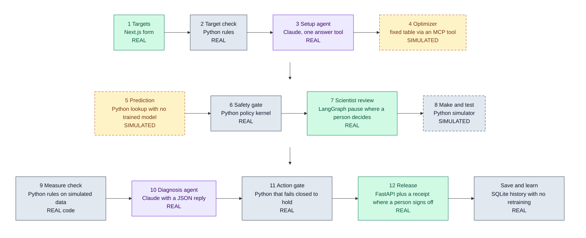

# SDL Control Plane

A prototype console for a self-driving materials lab, where AI helps plan experiments, plain code enforces the safety rules, and a person approves the important steps.

**AI reads and explains, math predicts, code enforces, people approve.**

## How one run works

1. You enter targets like strength and temperature.
2. Code checks the targets are possible and stops the run if not.
3. An AI agent sets up the search.
4. An optimizer picks a recipe (simulated).
5. A prediction model scores it (simulated).
6. A safety gate blocks banned elements like hafnium.
7. A scientist reviews risky recipes.
8. The lab makes and measures the sample (simulated).
9. Code checks the measurements.
10. An AI agent diagnoses problems and suggests a next action.
11. A second code gate decides, and holds if anything is unclear.
12. A person signs off on release and the result is saved.



Colors: green is a person, purple is an AI agent, yellow is math, gray is code. Dashed means simulated, not real. In step 3, code runs the literature lookup first, then Claude reads it and gives one answer.

## Real vs simulated

**Real:** the two AI agents (Claude), the safety gates, the checks, the review pauses and the traces.

**Simulated:** the optimizer, the prediction model, the lab and the measurements.

## Design decisions

The one-line rule: **AI reads and explains, math predicts, code enforces, people approve.**

Each decision below is a call a product manager has to make for a system like this. For each one: what I chose, what I passed on, and the trade-off I accepted.

### 1. One setup agent, not two AI steps
* **Chose:** one AI call per batch that reads the papers and past results and returns the search space.
* **Passed on:** a separate literature lookup and setup agent (two AI steps, one of them a back-and-forth tool loop).
* **Why:** it is one job (decide what is worth exploring), so one owner is easier to evaluate and explain.
* **Trade-off:** lower cost and latency (one call, and the unchanging instructions are cached so repeat batches are cheaper). I gave up tuning or swapping the two roles separately.

### 2. The AI draws the box, math picks the recipe
* **Chose:** the AI sets which elements are allowed and a range for each. A numeric optimizer picks the exact percentages.
* **Passed on:** letting the AI write full recipes.
* **Why:** AI is good at judgment about what to explore and unreliable with precise numbers. An optimizer is testable, and the AI can never invent a recipe.
* **Trade-off:** I need a real optimizer. Today it is simulated.

### 3. Rules live in code, prompts are only context
* **Chose:** "no hafnium" and "never repeat a failed run" are enforced by code: the AI's answer format does not allow hafnium, and the safety gate blocks it.
* **Passed on:** relying on a line in the prompt.
* **Why:** a prompt is a request the AI can miss. Code is a guarantee, it can be audited, and it does not change when the model changes.
* **Trade-off:** changing a rule means changing code. In return the check is free and instant, with no AI call.

### 4. The AI recommends, a gate decides
* **Chose:** the diagnosis agent can only suggest "re-measure" or "hold". A separate code gate checks the suggestion and falls back to "hold" if anything looks off.
* **Passed on:** letting the agent act on its own.
* **Why:** it limits the damage if the AI is wrong. The worst case is a wasted suggestion.
* **Trade-off:** safe but strict. When the agent's answer is not in a form the gate accepts, the gate holds the sample, so the AI call is paid for and not used. That is the next thing to fix.

### 5. A scientist approves before anything is made
* **Chose:** risky recipes pause for a scientist before synthesis.
* **Passed on:** reviewing after the scan, which is how an earlier version worked.
* **Why:** making a sample costs real time and money and cannot be undone. Review after the fact is too late.
* **Trade-off:** latency. A paused recipe can wait hours or days, but the workflow saves its place so waiting costs nothing. The review threshold is a dial: lower means fewer interruptions and more missed risks, higher means safer and more reviews. The evals show that tradeoff directly.

### 6. Notes from people are data, never instructions
* **Chose:** scientist notes and past comments are shown to the AI as quoted information only.
* **Passed on:** letting notes steer the agent.
* **Why:** anyone who can write a note could otherwise steer the system. This is protection against prompt injection (instructions hidden in data the AI reads).
* **Trade-off:** a note can inform the agent but never command it. Hard limits sit in code, so even a fooled agent cannot break them.

### 7. Plain-code checks first, an AI judge later
* **Chose:** the first evaluators are rules written in code.
* **Passed on:** using an AI to grade everything.
* **Why:** code checks cost nothing, run instantly and give the same answer every time. An AI judge costs tokens, adds latency and can vary. I keep it for subjective calls.
* **Trade-off:** code checks only catch what I thought to write down. The error analysis fills that gap.

## What the tests found

* 20 test cases ran through the loop, each traced in Phoenix.
* Two checks pass on all 20: impossible targets get flagged, and banned elements get blocked before anything is made. (The banned element check has nothing to score on the 5 runs that stop at the target check.)
* 9 deliberate mistakes were planted to prove the checks fail when they should. All 9 were caught.
* The diagnosis agent's reply is cut off at the 400 token limit in 10 of 11 cases, so the gate holds the sample. The likely fix is a higher token limit.
* Scientist review only fired on a planted test sample and never on the optimizer's own pick. A unit test covers the pick, but the traces do not.
* The results were labeled by me, not a scientist.

## Run it

```bash
./start.sh
```

Then open http://localhost:3000. The API docs are at http://localhost:8000/docs and the trace viewer (Arize Phoenix) is at http://localhost:6006. Needs Python 3.11 or newer and Node.js 18 or newer. The first start takes a few minutes.

Add your ANTHROPIC_API_KEY to .env. The setup and diagnosis agents call Claude.

## Repo layout

```
backend/app/
  api.py                 FastAPI routes the console calls
  orchestrator.py        Starts a run and resumes it after a scientist review
  graph.py               The LangGraph workflow that runs the steps in order
  target_check.py        Step 2: stops the run on impossible targets
  targets.py             Customer targets for a campaign
  setup_agent.py         Step 3: Claude sets up the search space
  history.py             What earlier runs feed back to the setup agent
  optimizer.py           Step 4: simulated optimizer (a fixed table)
  prediction_model.py    Step 5: simulated prediction model (a fixed lookup)
  proposer.py            Gathers the candidates for the safety gate
  policy_kernel.py       Step 6: safety gate (banned elements, repeated failures)
  presynthesis.py        Step 7: decides which recipes a scientist must review
  measure.py             Step 8: simulated measurements
  workcell.py            Step 8: simulated lab readings
  check.py               Step 9: measurement check
  diagnosis.py           Step 10: diagnosis agent (Claude)
  action_gate.py         Step 11: action gate (holds when unclear)
  release.py             Step 12: release check and sign off
  steps.py               The loop definition the UI and traces read from
  mcp_server.py          MCP tools: optimizer, failed run lookup, literature search
  literature.json        The curated papers the setup agent can cite
  chemistry.py           Reads and normalizes compositions
  db.py                  SQLite storage for campaigns, plans and samples
  config.py              Settings read from .env
  llm_usage.py           Times and prices every Claude call
  telemetry.py           Phoenix tracing through OpenTelemetry
  front_half_cases.py    Builds the 20 test cases
  front_half_runner.py   Runs the 20 cases with tracing on
  front_half_evals.py    The two code checks, scored on the traces
  run_evals.py           Earlier evals and the review threshold comparison
  promote_overrides.py   Turns scientist overrides into a labeling dataset
  synth_cases.py         Generator for an earlier batch of test cases
  seed_camp014.py        Demo campaign data
  seed_phoenix.py        Demo traces for Phoenix
backend/data/front_half/
  cases.json, golden.json    The 20 cases and their expected answers
backend/tests/           pytest suite, one file per area (test_front_half.py covers the new checks)
frontend/app/page.tsx    The page and its tabs
frontend/components/
  ConsoleTab.tsx         Lab Control Console: run a batch, review, release
  LoopStrip.tsx          The loop at a glance
  ReleaseCard.tsx        Release sign off card
  ArchitectureTab.tsx    System Architecture tab
  EvalsTab.tsx           Evals tab (hidden for now)
frontend/lib/api.ts      Types and calls for the backend API
start.sh                 Starts Phoenix, the API and the console
```

## Next

* Fix the diagnosis token limit.
* Add a third check that the diagnosis reply is read correctly.
* Review only when confidence is low, rolled out in stages.
* Replace the simulated parts with real ones.
